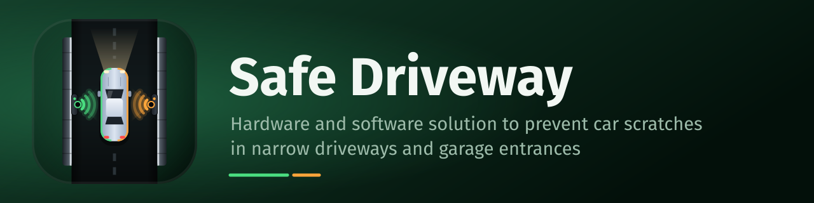
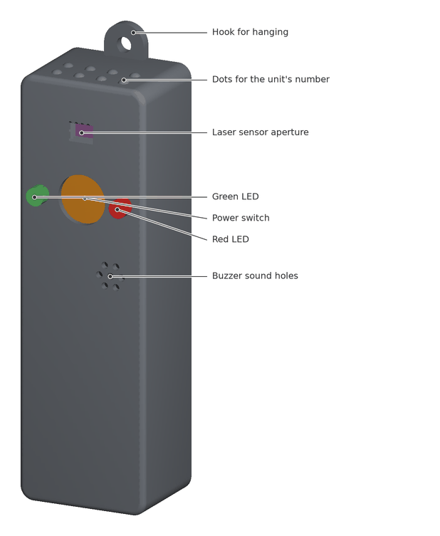
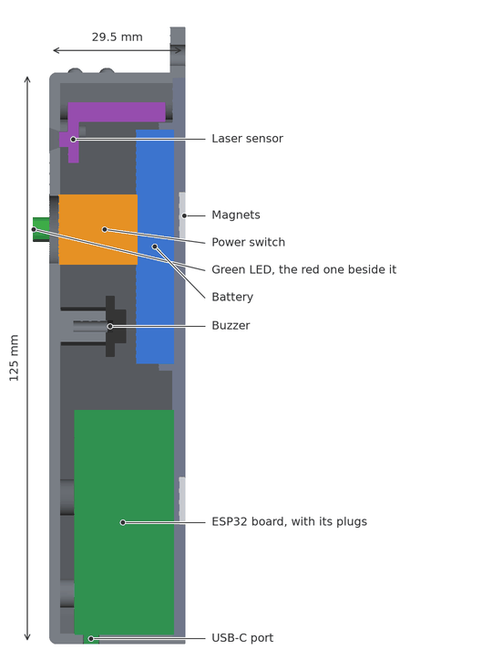
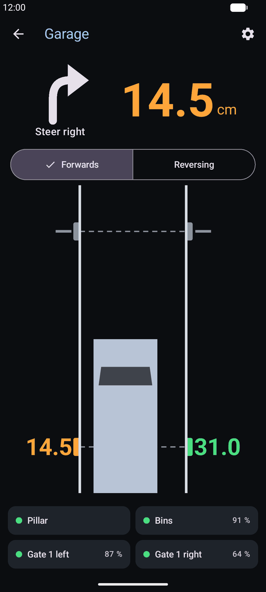
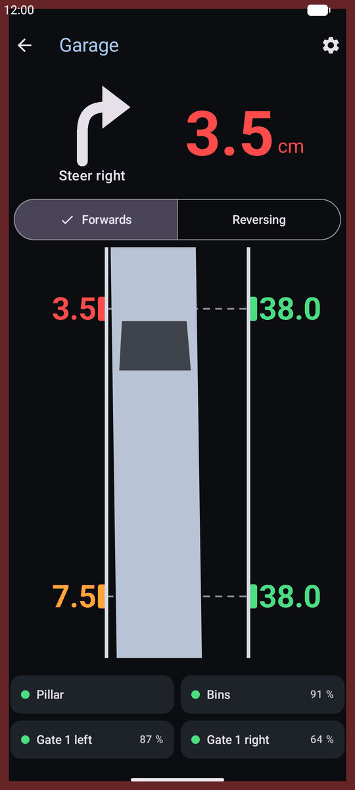
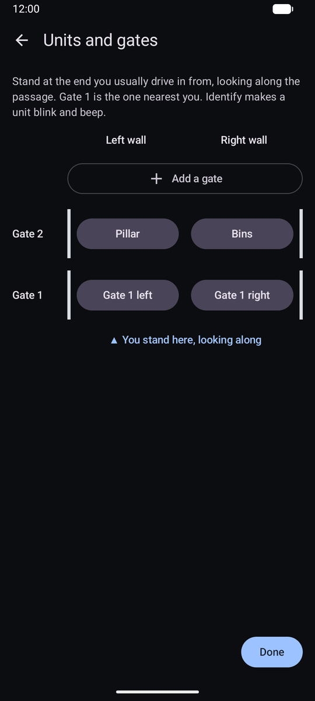

<h1 align="center"></h1>

Hardware and software solution to prevent car scratches in narrow driveways and garage entrances

## The problem

Some passages leave almost no room for error: a garage entrance, a gate, a driveway between two walls. When the opening is only 5–30 cm wider than the car, a few centimetres of misjudgement on either side means damaged side panels and scuffed bumpers.

In these situations the usual driver aids often don't help:

- **Judging the distance by eye is unreliable.** From the driver's seat you can't see how much space is left on each side, especially when the car isn't perfectly centred.
- **Side distance sensors may be missing.** Many cars only have parking sensors at the front and rear.
- **Side sensors that are present may be too coarse.** Their resolution is often too low to tell 5 cm from 15 cm, and they typically warn only when you are already too close.
- **The rearview mirrors have to be folded in.** In a tight passage there is simply no room for them, so the driver loses the view along the sides of the car.
- **360° cameras don't solve it either.** Where a car has them, they depend on the mirror-mounted cameras. With the mirrors folded, those cameras no longer see the sides of the car.

The result is that the driver inches through the passage, often with a passenger standing outside to give directions, or stops and gets out repeatedly to check the gap.

## The idea

Instead of relying on what the car can see, **put the sensing at the passage itself.**

You place one or more small remote devices at the narrow spot. They communicate with a mobile phone inside the car and report the car's exact position relative to the passage. The phone shows the driver how far the car is from each side, so they can steer through with confidence.

## Prototype hardware

The first prototype of the remote device is built from off-the-shelf parts:

- **ESP32 development board** compatible with the WEMOS LOLIN32 Lite, with a built-in Li-Po charger, Wi-Fi, Bluetooth, MicroPython support and a USB-C connector
- **VL53L1X laser time-of-flight (ToF) distance sensor**
- **YL-44 active buzzer module** for audible signalling
- **Li-Po battery 803450**, 3.7 V, 1500 mAh
- **Mini round rocker switch**, ON-OFF, for a 15 mm hole, used as the power switch
- **Green and red 5 mm LED** for visual status
- **3D-printed enclosure**, 39 × 125 × 29.5 mm, held on a steel wall or gate by two magnets, or hung from a nail by a hook on top, with the sensor, the switch, the LEDs and the buzzer on its front, and 1 to 8 dots on top to tell the units apart ([device/enclosure/](device/enclosure/README.md))

The device talks to the phone over Bluetooth Low Energy, using the protocol in [doc/ble-protocol.md](doc/ble-protocol.md). Its firmware, in MicroPython, implements that protocol, and signals the gap and its own state with the LEDs and the buzzer ([device/firmware.md](device/firmware.md)). [device/prototype-assembly.md](device/prototype-assembly.md) describes how to wire and assemble a unit, [device/README.md](device/README.md) how to set up a computer to flash, install and test it, and [doc/adr/](doc/adr/) records the decisions behind the hardware, the communication method and its protocol, the device's toolchain, its firmware and its enclosure, the app platform, the app's toolchain, its screens, and its connections, storage and sounds.

  
  

*The unit's 3D-printed enclosure from the front, and in section with the parts inside it, drawn from its model.*

## Mobile app

The app on the phone runs on Android and iOS. It is written once in Kotlin Multiplatform, with [Kable](https://github.com/JuulLabs/kable) for Bluetooth Low Energy and Compose Multiplatform for the screens ([ADR 0006](doc/adr/0006-kotlin-multiplatform-app.md)). [app/features.md](app/features.md) describes what it does: up to 8 units at a passage, their setup and status, and one screen with each gap, the car's position, steering suggestions and an alarm when the car gets too close. Its code is in [app/](app/). So far it's built for Android 12 and later, with iOS to follow ([ADR 0008](doc/adr/0008-app-development-toolchain.md)). It connects to the units, keeps what it stores encrypted on the phone and sounds the alarms itself ([ADR 0011](doc/adr/0011-app-connections-storage-and-sounds.md)). A demo mode runs it on pretend units with a simulated car, to try it without them ([ADR 0009](doc/adr/0009-app-screens-and-navigation.md)); [app/screens.md](app/screens.md) describes its screens. [app/README.md](app/README.md) describes how to set up a computer to build it and run it on a phone.

  
  
  

*The main screen during a pass, the same below the critical gap, and the board that gives each unit its gate and side, in demo mode.*
