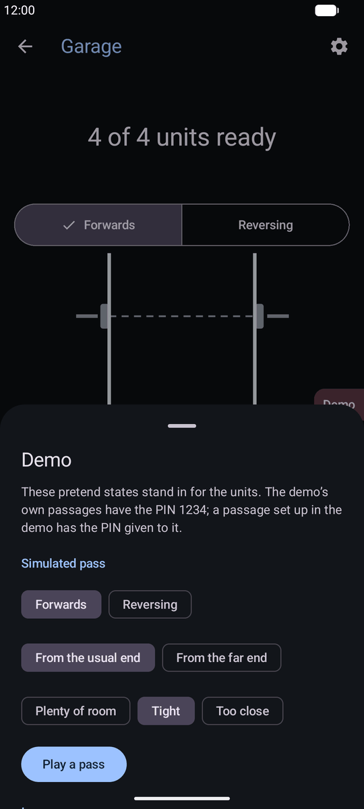

# Mobile app

This folder holds the mobile app that runs on the phone in the car, and the tasks to build it, run it and check it. [features.md](features.md) describes what the app does. It's written in Kotlin Multiplatform for Android and iOS ([ADR 0006](../doc/adr/0006-kotlin-multiplatform-app.md)), and for now it's built for Android only ([ADR 0008](../doc/adr/0008-app-development-toolchain.md)).

| Path | What it is |
|---|---|
| [features.md](features.md) | What the first version of the app does |
| [screens.md](screens.md) | What each screen shows, and how the driver moves between them |
| [screenshots/](screenshots/) | Screenshots for the documentation, from the emulator on the demo backend, with the debug build's **Demo** tab painted out where it isn't the subject |
| [artwork/](artwork/) | The app's icon and the header of the project's [README](../README.md), as SVG, and what Android's adaptive icon is made from |
| [shared/](shared/) | The code for both platforms: the logic, the BLE connections and the screens, in Compose Multiplatform. Its texts are in `shared/src/commonMain/composeResources/`, in English (`values/`) and Czech (`values-cs/`). For now the screens run on a demo backend instead of the units ([ADR 0009](../doc/adr/0009-app-screens-and-navigation.md)) |
| [androidApp/](androidApp/) | The Android application around `shared/`: its manifest, with the Bluetooth permissions, its icon (drawn from [artwork/](artwork/)) and its activity, whose screen `shared/` sets. It has no Compose code of its own |
| [justfile](justfile) | The tasks listed under [Tasks](#tasks) |
| [tools/Doctor.java](tools/Doctor.java) | The check that `just doctor` runs |
| [gradle/libs.versions.toml](gradle/libs.versions.toml) | The versions of every library and Gradle plugin, and the Android versions the app supports |
| [gradle/gradle-daemon-jvm.properties](gradle/gradle-daemon-jvm.properties) | The JDK that the build runs on |
| `gradlew`, `gradlew.bat`, `gradle/wrapper/` | The Gradle wrapper, pinned to one Gradle release |
| `settings.gradle.kts`, `build.gradle.kts`, `gradle.properties`, `.editorconfig` | The rest of the Gradle build, and the code style |

Why the tools were chosen is recorded in [ADR 0008](../doc/adr/0008-app-development-toolchain.md).

## Setup

You need a computer with Linux, macOS or Windows, and to run the app, an Android phone with Android 12 or later and a USB cable that carries data. Linux is tested (Pop!_OS 24.04); macOS and Windows should work but are untested.

1. Install a JDK, version 17 or later, if `java -version` doesn't show one. On Debian, Ubuntu and Pop!_OS: `sudo apt install openjdk-21-jdk-headless`. The build itself runs on JDK 21, which Gradle downloads on the first build if this computer doesn't have it.
2. Install [Android Studio](https://developer.android.com/studio) and go through its setup wizard with the standard settings. The wizard installs the Android SDK, in `~/Android/Sdk` on Linux, `~/Library/Android/sdk` on macOS and `%LOCALAPPDATA%\Android\Sdk` on Windows. If your SDK is somewhere else, set `ANDROID_HOME` to it.
3. Install [just](https://just.systems). If you already work on the device, you have it; otherwise `uv tool install rust-just` or [another way](https://just.systems/man/en/packages.html).
4. Turn on USB debugging on the phone. On most phones:
   1. Open *Settings > About phone* and tap *Build number* 7 times.
   2. Open *Settings > System > Developer options* and turn on *USB debugging*.
   3. Plug the phone in, unlock it and accept *Allow USB debugging?*.
5. Go to this folder and run the checks:

   ```bash
   cd app
   just doctor
   ```

   `doctor` checks the JDK, finds the Android SDK and its adb, and looks for the phone. It says how to fix anything that's wrong, and never changes your system itself.
6. To edit the code, open this folder, `app/`, in Android Studio with *File > Open*. It's the root of the Gradle project.

### Phone over USB on Linux

- **`doctor` says you aren't allowed to open the phone over USB.** Your distribution's udev rules for Android phones are missing. On Debian, Ubuntu and Pop!_OS, install them with `sudo apt install android-sdk-platform-tools-common`, then replug the phone.
- **`doctor` warns about another adb on PATH.** Your distribution's adb, such as `/usr/bin/adb` from the `adb` package, is a different version from the SDK's. When both run, they keep restarting each other's server and the phone disconnects. The tasks and Android Studio use the SDK's adb. Remove the other one (`sudo apt remove adb`), or put the SDK's `platform-tools` folder first on PATH.

## Tasks

Run the tasks from this folder or any folder below it. `just` on its own lists them.

| Task | What it does |
|---|---|
| `just doctor` | Checks that this computer is ready to build the app and run it on a phone, and says how to fix what isn't |
| `just build` | Builds the debug APK into `androidApp/build/outputs/apk/debug/` |
| `just run` | Installs the debug build on the phone connected over USB and starts it |
| `just test` | Runs the unit tests |
| `just lint` | Checks the code style with ktlint and runs Android Lint, without changing anything |
| `just fmt` | Formats the code and fixes what ktlint can fix by itself |

The tasks run the Gradle wrapper, `./gradlew`, which Android Studio runs too. When more than one phone or emulator is connected, choose one with `ANDROID_SERIAL`; `adb devices` lists them:

```bash
ANDROID_SERIAL=emulator-5554 just run
```

Run `just lint` before finishing a change. The code style is ktlint's Android Studio style, set in [.editorconfig](.editorconfig), so *Code > Reformat Code* in Android Studio and `just fmt` agree.

The emulator that Android Studio's wizard creates runs the app, but it has no real Bluetooth: test anything that talks to the units on a phone.

## Demo panel

For now the app has no BLE code: its screens run on pretend units ([ADR 0009](../doc/adr/0009-app-screens-and-navigation.md)), so they work on any phone or the emulator. In a debug build, such as `just run` installs, the **Demo** tab on the right edge of every screen opens the demo panel. It chooses which passages are in range and which problems the units have, and *Play a pass* drives a simulated car through the open passage. The demo's own passages have the PIN 1234, and a passage set up in the demo has the PIN given to it. [screens.md](screens.md#demo-panel) lists what it can do.



The screens' `@Preview` functions, in `shared/src/commonMain/kotlin/.../ui/Previews.kt`, show the main states in Android Studio.

## Screenshots

The screenshots in [screenshots/](screenshots/) appear in [screens.md](screens.md), in this file and in the repository's [README](../README.md). When a screen's look changes, retake every screenshot of it ([AGENTS.md](../AGENTS.md)):

1. Start the emulator that Android Studio's wizard creates, with the app in English, and install the debug build on it:

   ```bash
   ANDROID_SERIAL=emulator-5554 just run
   ```

2. Give the status bar a fixed clock, a full battery and no notifications, with SystemUI's demo mode. Use the SDK's adb, see [Phone over USB on Linux](#phone-over-usb-on-linux):

   ```bash
   adb shell settings put global sysui_demo_allowed 1
   adb shell am broadcast -a com.android.systemui.demo -e command enter
   adb shell am broadcast -a com.android.systemui.demo -e command clock -e hhmm 1200
   adb shell am broadcast -a com.android.systemui.demo -e command battery -e level 100 -e plugged false
   adb shell am broadcast -a com.android.systemui.demo -e command notifications -e visible false
   ```

3. Put the screen in the state the table below gives, with the [demo panel](#demo-panel), and take it at full size. For a pass, take a few in a row and keep the one that matches:

   ```bash
   adb exec-out screencap -p > shot.png
   ```

4. Save it under the same name at half size, 540 × 1200, as a PNG with 256 colours. Where the **Demo** tab lies over plain background, paint it out with the background around it; `demo-panel.png` keeps it.
5. Update the image's `alt` text where it's shown, which says what the screenshot shows, such as the gaps.

| File | Screen and state |
|---|---|
| `main-screen.png` | The garage during a *Tight* pass, forwards from the usual end, with only gate 1 seeing the car |
| `critical.png` | The garage during a *Too close* pass, with both gates seeing the car and the gap below the critical gap |
| `unit-details.png` | The details of *Bins*, with the *Low battery* and *Setup out of date* problems on |
| `notices-sheet.png` | The notices, with the same problems on |
| `passages.png` | The passages list, with the garage in range |
| `units-and-gates.png` | The garage's *Units and gates*, from *Change the setup* with PIN 1234 |
| `demo-panel.png` | The demo panel over the garage's main screen, with *Tight* chosen |

## Versions

Every library and Gradle plugin version is in [gradle/libs.versions.toml](gradle/libs.versions.toml), with the Android versions the app supports. Three things are set elsewhere:

- **Gradle:** in `gradle/wrapper/gradle-wrapper.properties`, with the checksum of its download. Update it with `./gradlew wrapper --gradle-version <version> --gradle-distribution-sha256-sum <checksum>`, using the checksum that [gradle.org](https://gradle.org/release-checksums/) publishes.
- **The JDK:** in `gradle/gradle-daemon-jvm.properties`. Update it with `./gradlew updateDaemonJvm --jvm-version <version>`.
- **The toolchain resolver,** which finds a JDK to download: in `settings.gradle.kts`, where the version catalog can't be used.

A Kable upgrade is tested against a real unit before it's merged ([ADR 0006](../doc/adr/0006-kotlin-multiplatform-app.md#consequences)).

## Continuous integration

[.github/workflows/app.yml](../.github/workflows/app.yml) runs `just lint`, `just test` and `just build` on GitHub for every pull request and every push to `main` that changes this folder. The debug APK it builds can be downloaded from the run's page for 14 days.

## iOS

The iOS app isn't built yet ([ADR 0008](../doc/adr/0008-app-development-toolchain.md)). It needs a Mac with Xcode. Adding it means the iOS targets in `shared/build.gradle.kts`, an Xcode project in `iosApp/`, and `NSBluetoothAlwaysUsageDescription` in its `Info.plist`. Until then, code in `shared/src/commonMain` uses no Android API.
