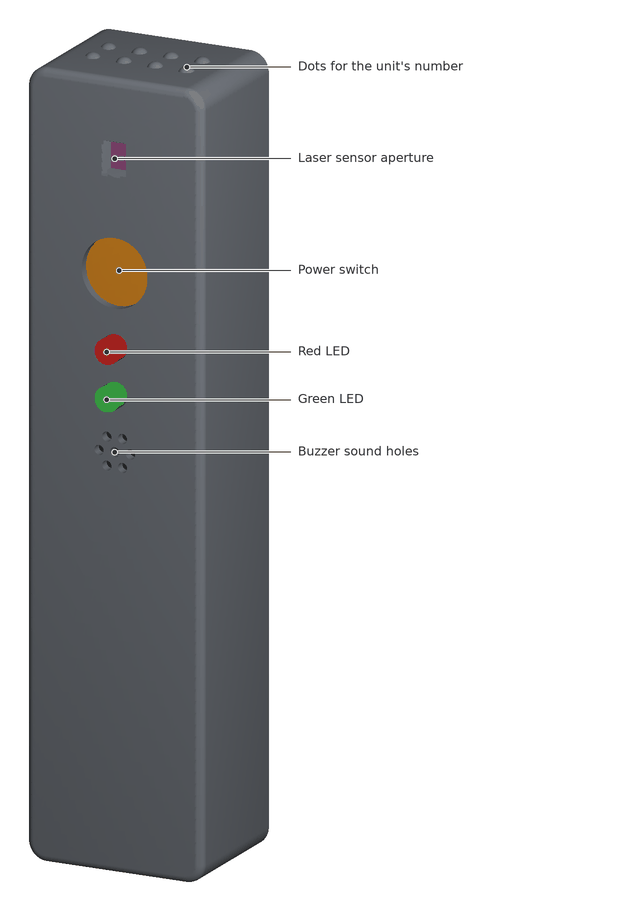
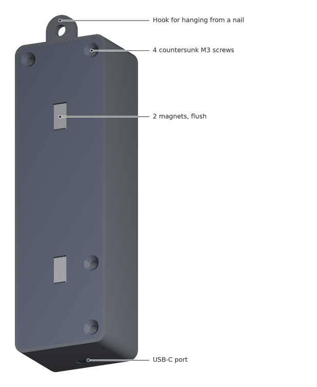
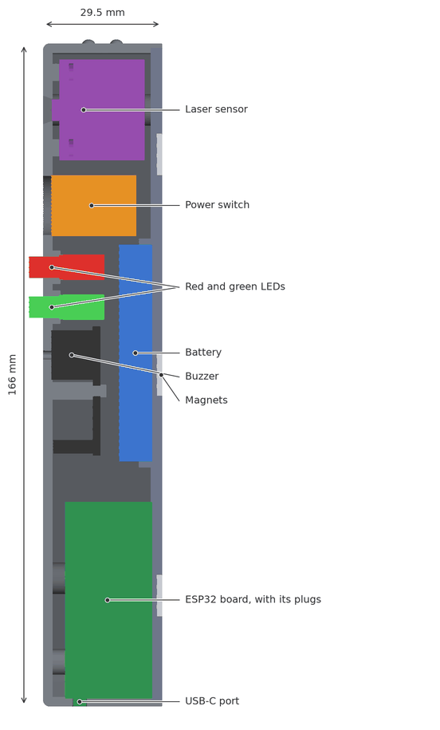
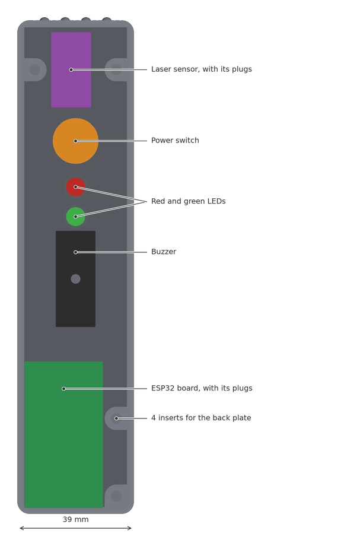
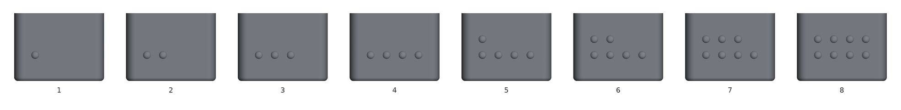
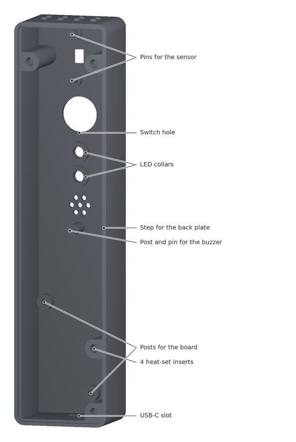

# 3D-printed enclosure

The unit's enclosure is a front tub and a back plate, 39 × 166 × 29.5 mm (width × height × depth), printed in two parts and screwed together. It stands upright on the passage wall or gate, held by three magnets in its back. Everything the driver sees and the switch are on the front, and the USB-C port is in the bottom. Each of the up to 8 units at a passage gets its own tub, with as many dots on top as its number, so that the units can be told apart. Why it is built this way is recorded in [ADR 0012](../../doc/adr/0012-3d-printed-enclosure.md). The wiring and the rest of a unit's assembly are in [prototype-assembly.md](../prototype-assembly.md).

<p>
  
  
</p>

*The enclosure from the front and from the back. The pictures are drawn from the model.*

| Path | What it is |
|---|---|
| [model.py](model.py) | The model, in [build123d](https://build123d.readthedocs.io): the sizes of the enclosure and of the parts it holds, and the check that they fit |
| [\_\_main\_\_.py](__main__.py) | What `just enclosure` runs: the check, then the print files and the pictures |
| [pictures.py](pictures.py) | Draws the pictures in this README from the model |
| [pictures/](pictures/) | The pictures |
| [print/tub-1.stl](print/tub-1.stl) … [print/tub-8.stl](print/tub-8.stl) | The tub, one for each unit number: the front, the walls, the posts that hold the parts, and 1 to 8 dots on top |
| [print/back-plate.stl](print/back-plate.stl) | The back plate, with the magnet pockets and the ribs that hold the battery |
| [print/enclosure.step](print/enclosure.step) | Both parts, for opening in another CAD program |

## Layout

<p>
  
  
</p>

*A section through the middle, with the front on the left, and the inside from the back with the back plate off. The board and the sensor are drawn as the room they take with their Dupont plugs and wires, and the battery comes off with the back plate.*

- **Front:** from the top, the sensor's aperture, the rocker switch, the red LED above the green one, and the buzzer's sound holes. The LEDs' domes stand about 3.5 mm out of the front, so that an approaching driver can see them from the side.
- **Top:** 1 to 8 raised dots, 3 mm across and 1 mm high, for the unit's number. They fill a 4 × 2 grid from the front left, a row at a time.
- **Bottom:** the board's USB-C port, flush with the outside, so that any cable fits.
- **Back:** three 10 × 5 × 1 mm magnets, flush, spread evenly along the length, and the heads of four countersunk screws.
- **Inside, from the bottom:** the ESP32 board, component side toward the back, with its USB-C end against the bottom wall and its antenna up. Above its antenna, 10 mm left clear. The battery, flat against the back plate between two ribs, with the buzzer and the LEDs in front of it. The switch. The sensor module at the top, upright, with its chip right behind the aperture.
- **Left and right:** everything is on the front, so the same unit fits either wall, the right way up. Which side a unit is on is set in software.



*The tops of the tubs for units 1 to 8, seen from above with the front at the bottom.*

The sensor's aperture is 4 × 6 mm at the chip, which is 3 × 5 mm, and widens toward the outside at 20° on each side, more than half the sensor's 27° field of view, so that its sides stay out of the sensor's view. The front is 2 mm thick there. There is no window: a window needs crosstalk calibration ([ADR 0004](../../doc/adr/0004-vl53l1x-distance-sensor.md)).

## Hardware

Besides the unit's parts in [prototype-assembly.md](../prototype-assembly.md#parts-list):

| Part | Qty | Notes |
|---|---|---|
| Neodymium magnet, 10 × 5 × 1 mm | 3 | Glued into the back plate |
| M3 heat-set insert, about 4.5 mm across, 5 mm long | 4 | For the screws that hold the back plate |
| M3 × 8 countersunk screw | 4 | Hold the back plate |
| M3 × 6 screw | 2 | Hold the board. They cut their own thread in its posts |
| Superglue or epoxy | | For the magnets |
| Double-sided foam tape | | Holds the battery on the back plate |
| Steel plate or large washers | | Only for a wall that isn't steel: glued or screwed to the wall, for the magnets to hold on to |

## Printing

Print in **PETG, dark and opaque**. PLA softens at about 55 °C, which a garage or a gate in the sun can reach. Light filament lets the LEDs glow through the walls. Don't use carbon-filled filament, which can block the radio.

The model is drawn for a 0.4 mm nozzle: 0.2 mm layers, at least 4 walls, so that the 2 mm walls are solid, and 20% infill. Neither part needs supports.

- **Tub:** the one with the unit's number, front down on the bed. The front comes out smooth, the holes in it, the posts and pins inside and the dots on top print without supports, and only the top of the USB-C slot bridges, over 10 mm.
- **Back plate:** outside down on the bed, so that the magnet pockets and the countersinks open onto the bed and the ribs point up.

The enclosure hasn't been printed yet. The holes for the switch (15.2 mm), the LEDs (5.1 mm), the inserts (4.1 mm) and the board's screws (2.7 mm), and the pins for the sensor and the buzzer (2.8 mm, in 3 mm holes), are drawn for a printer whose holes come out about 0.1 mm small. If one doesn't fit, change it in [model.py](model.py), see [Changing the model](#changing-the-model).

## Preparing the parts

1. **Inserts:** press the four M3 inserts into the posts at the back of the tub with the soldering iron, at about 230 °C for PETG, until they are flush with the post tops. The back plate rests on those tops.
2. **Magnets:** glue the three magnets into the pockets in the outside of the back plate, flush with its surface. A magnet that sits proud, or glue on top, lifts the plate off the steel and weakens the hold. Which pole faces out doesn't matter.
3. **Board:** drill its two mounting holes out from 2.5 to 3.2 mm, for M3 screws. Go slowly, to keep the copper around them intact.
4. **Pin headers:** on the board and the sensor, trim the soldered ends of the pins to 1.5 mm with flush cutters. The board then sits flat on its posts, and the sensor's chip right behind the front.

## Fitting the parts

Wire the front parts as you fit them, as [prototype-assembly.md](../prototype-assembly.md#assembly-steps) describes. The parts on the front go in first, the board last.



*The tub from the back, before the parts go in.*

1. **Switch:** feed its wires through the 15 mm hole from the outside, then push it in until its clips catch.
2. **LEDs:** red in the upper hole, green in the lower one. Push each in from the inside until its flange rests on its collar; the dome then stands out of the front. A drop of glue on the flange keeps it there.
3. **Buzzer:** with its buzzer toward the sound holes and its pins down, fit its hole over the pin below the sound holes, so that its board rests on the post around the pin. Melt the tip of the pin over the board with the soldering iron.
4. **Sensor:** peel off the protective film over the chip, if there is one. Fit the module's two holes over the two pins at the top, chip toward the aperture, with its pins toward the right-hand wall as seen from the front, which is on your left as you look into the tub. Turned the other way, the chip sits 3 mm to the side of the aperture. Check that the chip fills the middle of the aperture, then melt the tips of the pins over the module. Keep glue and molten plastic off the chip.
5. **Board:** component side toward you, USB-C end down into the slot, which takes the port from the inside. Screw it onto its two posts with the M3 × 6 screws, without forcing them: they cut their own thread. The upper screw sits next to the antenna; a nylon M3 screw there keeps metal away from it, if you have one.
6. **Wires:** plug the Dupont wires onto the board and the sensor, and run the wires along the side walls. Keep them, and anything metal, at least 10 mm away from the board's antenna, the end away from the USB-C.
7. **Battery:** stick it onto the back plate with foam tape, between the two ribs, with its cable at the top, through the gap at the left end of the upper rib as seen from the front.
8. **Close:** after the bring-up tests pass, put the back plate into the step around the back of the tub and screw it on with the four countersunk M3 × 8 screws.

## Mounting

Put the unit on the passage wall or the gate with its back against the steel, upright, with the front facing the passage. On masonry, glue or screw a steel plate or large washers to the wall where the magnets will sit. The unit comes off by hand for charging.

## Changing the model

The sizes of the enclosure and of the parts it holds are named at the top of [model.py](model.py). In the `device/` folder:

```bash
just enclosure
```

It builds both parts, checks that everything fits, and writes the files in [print/](print/) and the pictures in this README, in [pictures/](pictures/), which takes about a minute. The first run installs build123d and its CAD kernel, and matplotlib for the pictures, about 800 MB, into `device/.venv`. Commit the print files and the pictures in the same change as the model; they change only when the model does.

The check models each part the enclosure holds as the outline of its measured size: the board with its Dupont plugs and their bent wires, the sensor, the switch with its wires, the buzzer, the LEDs with their legs and resistors, and the battery. It fails, writing nothing, when a part runs into the enclosure or into another part, when the box gets deeper than 30 mm, or when the battery comes within 10 mm of the board's antenna.

## Known limitations

- **Not printed yet.** The sizes come from measurements of the parts, and the holes may need adjusting after the first print, see [Printing](#printing).
- **The antenna faces the steel.** On a steel gate, the board's antenna is about 20 mm in front of the steel, which can shorten the Bluetooth range. Check the range on the gate with `just ble watch`.
- **The LEDs are side-on to an approaching driver.** Their domes stand out of the front, but they are brightest seen from the passage.
- **Dupont plugs can work loose** on a gate that swings or vibrates.
- **Indoor use only.** The aperture is open and the switch isn't waterproof.
