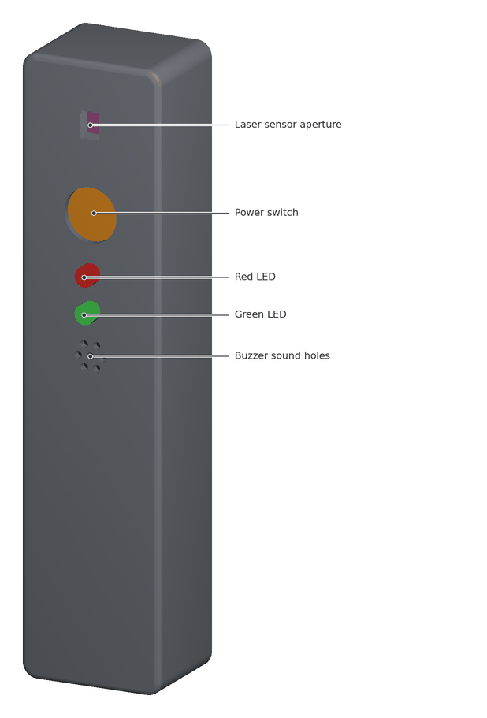
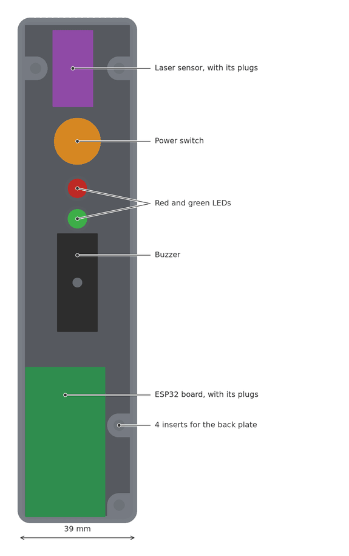

# Prototype unit: wiring and assembly

This document describes how to wire and assemble one unit of the first Safe Driveway prototype. Why these parts were chosen is recorded in [ADR 0001](../doc/adr/0001-prototype-hardware.md), and the choice of Bluetooth Low Energy in [ADR 0002](../doc/adr/0002-ble-communication.md). The unit goes into the 3D-printed enclosure in [enclosure/](enclosure/README.md), see [Enclosure](#enclosure).

This document covers hardware only. The distance thresholds are set per passage from the app, and when the unit measures and signals is set by the protocol in [doc/ble-protocol.md](../doc/ble-protocol.md). The blink and beep patterns are defined by the firmware, see [firmware.md](firmware.md#lights-and-sounds). How to set up a computer to flash and test a unit is in [README.md](README.md).

## What each part does

| Part | Job |
|---|---|
| ESP32 board | Runs the firmware, talks to the phone over BLE using its built-in radio, and charges the battery over USB-C |
| VL53L1X laser sensor | Measures the distance from the unit to the side of the car |
| YL-44 buzzer | Signals the distance with sound |
| Green LED | Shows the unit's state: on, connected to a phone, a car in front, or a fault |
| Red LED | Signals the distance with light |
| Rocker switch | Switches the unit on and off |
| Battery divider (optional) | Lets the firmware measure the battery voltage |

## Parts list

| Part | Qty | Notes |
|---|---|---|
| ESP32 development board with Li-Po charger and USB-C | 1 | [dratek.cz 232739](https://dratek.cz/arduino-platforma/232739-vyvojova-deska-esp32-s-bms-pro-lipol-baterii-wi-fi-bluetooth-micropython-usb-c.html). A WEMOS LOLIN32 Lite clone: CH340, TP4054-class charger, JST-PH 2 mm battery socket, 51 × 26 mm. Its two 2.5 mm mounting holes are drilled out to 3.2 mm for the enclosure |
| VL53L1X laser time-of-flight module | 1 | Any breakout with VIN, GND, SCL, SDA, XSHUT and GPIO1 pins and an onboard regulator works. VL53L0X modules look the same, so check the chip with `just bringup sensor`. See [ADR 0004](../doc/adr/0004-vl53l1x-distance-sensor.md) |
| YL-44 active buzzer module | 1 | [dratek.cz 849](https://dratek.cz/arduino-platforma/849-eses-akusticky-bzucak-pro-jednodeskove-pocitace.html). Pins VCC, I/O, GND |
| Li-Po battery 803450, 3.7 V, 1500 mAh | 1 | With a JST-PH 2.0 plug and a built-in protection circuit |
| Mini round rocker switch, ON-OFF, 15 mm hole | 1 | [rasel.cz 056-151](https://www.rasel.cz/kolebkovy-vypinac-0-1-250v-3a-mini-p17388/). Single pole, 250 V / 3 A, two solder tabs, no light. Snaps into a 15 mm round hole |
| 5 mm LED, green, diffused | 1 | Diffused, so that it can be seen from the side |
| 5 mm LED, red, diffused | 1 | |
| Resistor 220 Ω, ¼ W | 2 | One per LED |
| JST-PH 2.0 two-pin extension lead, 10–20 cm | 1 | Plug on one end, socket on the other. The battery plugs into its socket, and the switch is spliced into it so the battery leads are never cut. Its plug is cut off, and its wires soldered to the back of the board's battery socket |
| Pin headers, 2.54 mm, straight | | For the board and the sensor, if they came without them |
| Dupont jumper wires, female, 2.54 mm | | For the pins of the board and the sensor |
| 3D-printed enclosure | 1 | A tub and a back plate, with three magnets, four heat-set inserts and six M3 screws. See [enclosure/README.md](enclosure/README.md#hardware) |
| Stranded hook-up wire, 24–26 AWG, several colours | | Silicone insulation is easiest to route |
| Heat-shrink tubing, assorted | | |
| Double-sided foam tape, hot glue | | For the battery, the LEDs and strain relief |
| *Optional:* resistor 100 kΩ | 2 | Battery divider |
| *Optional:* ceramic capacitor 100 nF | 1 | Battery divider |

## Tools

- Soldering iron and solder. It also sets the enclosure's inserts and melts its pins
- Multimeter with continuity test
- Wire stripper and side cutters
- Heat gun or lighter for heat-shrink
- Drill with a 3.2 mm bit, for the board's mounting holes, and small files
- Flush cutters, to trim the pins' soldered ends
- A 3D printer, or a printing service, for the enclosure
- Hot glue gun
- Computer with a USB cable that carries data, set up as described in [README.md](README.md#setup), for flashing and testing the board

## Pin assignments

Pins are referred to by the label printed on the board. Clone boards place the pins in different orders, so go by the label, never by position.

| Board pin | Connects to | Notes |
|---|---|---|
| `3V` | VL53L1X `VIN`, YL-44 `VCC` | Via splice S1 |
| `GND` | VL53L1X `GND`, wall-A ground lead, divider (optional) | Via splice S2 |
| `18` | VL53L1X `SCL` | I2C clock |
| `19` | VL53L1X `SDA` | I2C data |
| `16` | VL53L1X `XSHUT` | Sensor shutdown. Firmware drives it open-drain: low = off, released = on |
| `17` | VL53L1X `GPIO1` | Sensor interrupt. Firmware enables the internal pull-up |
| `25` | YL-44 `I/O` | Low-triggered: LOW = sound, HIGH = silent. Check yours, see [Bring-up tests](#bring-up-tests) |
| `26` | Green LED anode, through 220 Ω | HIGH = on |
| `27` | Red LED anode, through 220 Ω | HIGH = on |
| `35` | Battery divider midpoint (optional) | Input only, on ADC1, which still works while the radio is on |

Leave the other pins unconnected. In particular:

- `0`, `2`, `5`, `12` and `15` are strapping pins. Anything connected to them can stop the board from booting or flashing. `12` is the most sensitive: if it is high at boot, the flash memory runs at the wrong voltage.
- `22` drives the board's own blue LED. Firmware can use it for debugging.
- `34`, `35`, `VP` (36) and `VN` (39) are inputs only.

## Wiring

### Power harness

The switch is spliced into the red wire of the JST-PH extension lead, between the battery and the board. The battery's own leads are never cut, and the battery can be unplugged at any time.

```
 battery plug          JST-PH extension lead               board battery
 (803450)                                                  socket (JST-PH)

  + red   ──────────────►  ┐
                           │  mini rocker switch (O / I)
                           └ ────────────────────────────────────►  +

  − black ───────────────────────────────────────────────────────►  −
```

- The switch has two terminals, and either one can take the battery side. Call the other one the board-side terminal: the battery divider connects there.
- The board's battery socket faces the enclosure's bottom wall, where no plug fits. The lead's plug is therefore cut off, and its wires are soldered to the back of the board's socket.
- The switch has no light, so the unit has no power light. While the firmware isn't running, only the rocker's position shows whether the unit is on.

### Battery divider (optional)

Fit this if you have the parts. It lets the firmware measure the battery voltage. Without it, everything else works the same, and the firmware must treat the measurement as optional.

```
 switch board-side terminal ── 100 kΩ ──┬── 100 kΩ ──► splice S2 (GND)
 (switched battery +)                   │
                                        ├── 100 nF ──► splice S2 (GND)
                                        │
                                        └────────────► pin 35
```

Pin 35 sees half the battery voltage: 1.5–2.1 V for a 3.0–4.2 V cell. That is within the ESP32 ADC's range at 11 dB attenuation. The divider draws about 20 µA, and only while the switch is on.

### Signal wiring

Every signal wire runs straight from a board pin to its part. At the board and the sensor, wires end in Dupont plugs on their pin headers; at the other parts, they are soldered. The board has only one `3V` pin and one `GND` pin, so wires that share them are joined in insulated solder splices instead of being stacked on the pin:

- **S1** (near the board): board `3V`, VL53L1X `VIN`, YL-44 `VCC`.
- **S2** (near the board): board `GND`, VL53L1X `GND`, the front ground lead, and the battery divider's ground (optional).
- **S3** (behind the LEDs): the front ground lead, YL-44 `GND`, green LED cathode, red LED cathode.

```
 board pin                                          part
 3V   ──[S1]──┬───────────────────────────────────►  VL53L1X VIN
              └───────────────────────────────────►  YL-44 VCC
 GND  ──[S2]──┬───────────────────────────────────►  VL53L1X GND
              ├── front ground lead ───[S3]──┬────►  YL-44 GND
              │                              ├────►  green LED cathode
              │                              └────►  red LED cathode
              └ ─ ─ ─ ─ ─ ─ ─ ─ ─ ─ ─ ─ ─ ─ ─ ─ ─ ►  divider ground (optional)
 18   ────────────────────────────────────────────►  VL53L1X SCL
 19   ────────────────────────────────────────────►  VL53L1X SDA
 16   ────────────────────────────────────────────►  VL53L1X XSHUT
 17   ◄───────────────────────────────────────────   VL53L1X GPIO1
 25   ────────────────────────────────────────────►  YL-44 I/O
 26   ────── 220 Ω ───────────────────────────────►  green LED anode
 27   ────── 220 Ω ───────────────────────────────►  red LED anode
 35   ◄ ─ ─ ─ ─ ─ ─ ─ ─ ─ ─ ─ ─ ─ ─ ─ ─ ─ ─ ─ ─ ─ ─   divider midpoint (optional)
```

Notes:

- **Power the YL-44 from `3V`, never from USB 5 V or the battery.** It switches the buzzer with a PNP transistor, and a 3.3 V HIGH from the ESP32 can only turn that transistor fully off if the module's VCC is also 3.3 V.
- **The VL53L1X module needs no extra pull-up resistors.** Its I2C pull-ups and its regulator are on the module.
- **LED legs:** the anode is the long leg; the cathode is the short leg, on the flat side of the rim. Solder each 220 Ω resistor directly to the anode leg and cover it with heat-shrink.
- **If the green LED is much dimmer than the red one,** it is probably a 3 V type. Swap its resistor for 100 Ω.

### Suggested wire colours

| Colour | Signal |
|---|---|
| Red | `3V` |
| Black | `GND` |
| Yellow | `18` SCL |
| Blue | `19` SDA |
| White | `16` XSHUT |
| Grey | `17` GPIO1 |
| Orange | `25` buzzer |
| Green | `26` green LED |
| Purple | `27` red LED |
| Brown | `35` battery sense |

## Enclosure

The unit goes into a 3D-printed enclosure, 39 × 166 × 29.5 mm, which stands upright on the passage wall or gate, held by three magnets in its back. [enclosure/README.md](enclosure/README.md) describes it, how to print it and how the parts go into it, and [ADR 0012](../doc/adr/0012-3d-printed-enclosure.md) why it is built this way.

Everything the driver sees is on the front, which faces the passage: from the top, the laser sensor's aperture, the power switch, the red LED above the green one, and the buzzer's sound holes. The board's USB-C port is flush in the bottom wall.

<p>
  
  
</p>

*The enclosure from the front, and the inside from the back with the back plate off. The battery sits on the back plate, behind the LEDs and the buzzer.*

A unit for the right-hand wall is the same as one for the left, the right way up. Which side a unit is on is set in software, not in hardware.

Inside, the enclosure is laid out for these:

- **Sensor:** the chip sits right behind the aperture. Peel off its protective film, if there is one, and keep glue off it. The aperture must not cut into the sensor's 27° field of view, and nothing shiny may sit inside that cone.
- **Antenna:** the board's PCB antenna, the zig-zag copper trace at the end opposite the USB-C port, must stay at least 10 mm from the battery and the wiring, with nothing metal over it.
- **Strain relief:** secure the wires near their solder joints with a dab of hot glue, so no joint carries the load.

## Assembly steps

### 1. Bench-check the board

Do this before soldering anything.

1. Connect the board to the computer by USB. No battery yet. If a USB-C to USB-C cable doesn't power the board, use a USB-A to USB-C cable; some clones lack the resistors that USB-C chargers look for.
2. In the `device/` folder, run `just doctor` and fix what it reports. See [README.md](README.md#setup) for setting up the computer.
3. Flash MicroPython with `just flash`. It shows the board's chip and MAC address, asks before erasing the board, and writes the release pinned in [micropython.toml](micropython.toml).
4. Check that the board responds with `just bringup board`. See [Board](#board).

### 2. Check battery polarity

JST-PH plugs are not wired the same way by every seller. A reversed battery can destroy the board.

1. Find the `+` and `−` marks next to the board's battery socket. If there are none, use the continuity test: the socket pin that connects to the board's `GND` pin is `−`.
2. With the multimeter, find which contact of the battery plug is `+` (red probe on it gives a positive reading).
3. Plug the battery into the extension lead, and check that the lead's red wire carries `+`.
4. If it doesn't, move the crimp contacts in the extension lead's socket: lift the small latch with a needle and swap them. Never modify the battery's plug.

### 3. Build the power harness

1. Check the switch with the continuity test: its two terminals connect when the rocker is pressed to `I` and disconnect at `O`.
2. Cut the plug off the extension lead. Cut its red wire, and solder the battery-side end to one terminal of the switch and the board-side end to the other. The black wire stays continuous.
3. Insulate both joints with heat-shrink.
4. Test it before connecting the board: plug in the battery. With the switch at `O`, the board end of the lead reads 0 V. At `I`, it reads the battery voltage (3.0–4.2 V).

### 4. Print and prepare the enclosure

Print the tub and the back plate, set the inserts, glue in the magnets and drill out the board's mounting holes, as [enclosure/README.md](enclosure/README.md#printing) describes.

### 5. Wire the front parts

Wire the parts on the front before fitting them: the buzzer's pins face the front once it is in.

1. Solder a 220 Ω resistor to the anode leg of each LED.
2. Join the two LED cathodes, the YL-44 `GND` and the front ground lead in splice S3.
3. Solder signal wires to the free ends of the resistors (green → pin `26`, red → pin `27`) and to the YL-44 `I/O` (→ pin `25`) and `VCC` (→ S1). Their other ends get Dupont plugs, or go into the splices near the board.
4. Fit the pin header to the sensor, its plastic on the side away from the chip, and trim the soldered ends on the chip side to 1.5 mm.

### 6. Fit the parts on the front

Feed both ends of the power harness through the switch's hole from outside, then fit the switch, the LEDs, the buzzer and the sensor into the tub, as [enclosure/README.md](enclosure/README.md#fitting-the-parts) describes in its steps 1–4.

### 7. Wire the board

1. Fit the pin headers to the board, their plastic on the component side, and trim the soldered ends to 1.5 mm, so that the board sits flat on its posts.
2. Solder the extension lead's board end to the back of the board's battery socket: the switched red wire to `+`, black to `−`.
3. Make splices S1 and S2 close to the board, with one Dupont wire from each splice onto the board's `3V` and `GND` pins.
4. Wire the sensor with Dupont wires: `VIN` → S1, `GND` → S2, `SCL` → `18`, `SDA` → `19`, `XSHUT` → `16`, `GPIO1` → `17`.
5. Optional: build the battery divider. Solder the resistors and the capacitor in-line close to the Dupont plug on pin `35`, with the top of the divider wired to the switch's board-side terminal.

### 8. Fit the board and the battery

Screw the board onto its posts, plug in the wires and stick the battery onto the back plate, as [enclosure/README.md](enclosure/README.md#fitting-the-parts) describes in its steps 5–7. Keep the wires away from the antenna, see [Enclosure](#enclosure), and add strain relief.

### 9. Run the bring-up tests

Run `just bringup` and answer its questions, and let it save its notes for the firmware on the board. Then check power and charging by hand. See [Bring-up tests](#bring-up-tests). Screw on the back plate only after every test passes.

### 10. Install the firmware

Run `just install`. The board restarts into the firmware: green and red light for a moment, then green flashes once every 3 s. Check that the unit answers with `just ble watch`, see [firmware.md](firmware.md#testing-without-the-app).

## Bring-up tests

Run them with the board connected over USB, through the port in the enclosure's bottom. The battery doesn't have to be switched on, except for the battery voltage test. In the `device/` folder:

```bash
just bringup
```

The run tests the board, the laser sensor, its distance readings and clear view, the LEDs, the buzzer and, if fitted, the battery divider. It verifies the board and the sensor by itself, and asks you to move your hand or aim the unit and to answer yes/no questions about what you see and hear. A failed test prints a hint and a link to its section below, and the run goes on with the next one. At the end it prints a summary, the notes the firmware needs and the tests still to do by hand, and offers to save the notes in `/unit.json` on the board, where the firmware reads them.

To run only some tests, name them, for example while wiring: `just bringup sensor leds`. The board test always runs first. The code of each test is in [board/bringup.py](board/bringup.py), which also says how to run a test by hand in the REPL.

### Board

The board answers over USB and prints its MicroPython version, CPU frequency and unique ID. The unique ID is also the board's MAC address, which tells units apart.

- **The board doesn't respond:** run `just doctor`. A new board needs `just flash` first.
- **It runs a different MicroPython version than the one pinned in [micropython.toml](micropython.toml):** run `just flash`.

### Laser sensor

The sensor answers at I2C address `0x29`, identifies itself as a VL53L1X (model ID `0xEACC` in 16-bit register `0x010F`), disappears from the bus while XSHUT is pulled low, and comes back when XSHUT is released.

- **Nothing found with XSHUT released:** the run tries again with the ESP32's weak internal pull-up on XSHUT. If the sensor then answers, the module has no pull-up on XSHUT. Add a 10 kΩ resistor from XSHUT to `3V`.
- **Nothing found at all:** check `3V`, `GND`, and whether SCL and SDA are swapped.
- **The sensor stays on with XSHUT low:** check the wire from pin `16` to XSHUT.
- **The sensor is a VL53L0X:** VL53L0X modules have the same pins and answer at the same address, so the wiring tests pass. The run recognises one by its model ID, `0xEE` in register `0xC0`. Its registers and driver differ from the VL53L1X's, so replace the module.

### Distance readings

The run measures in short distance mode, about 20 times a second, and shows the distance on one line for 10 seconds while you move your hand in front of the sensor, between 5 and 50 cm. It then asks whether the readings followed your hand. A target nearer than 4 cm shows as "closer than 4 cm". Without a target in range, the line shows "no reading" and the sensor's reason.

- **The readings don't change:** check that nothing covers the sensor chip: its protective film, glue, or the front.

To watch the readings for longer, for example while aiming a unit at the passage, run `just distance` and stop it with Ctrl-C. The driver is [board/lib/vl53l1x.py](board/lib/vl53l1x.py), see [ADR 0005](../doc/adr/0005-vl53l1x-driver.md).

### Clear view

When asked, point the sensor at open space, with nothing within 1.5 m. The run takes 20 measurements and passes if none sees a target closer than 1 m, including one too close to measure.

- **It sees something close:** something sits in the sensor's 27° field of view, such as the edge of the aperture, glue, a wire or the chip's protective film. See [Enclosure](#enclosure).

### LEDs

The run lights the green LED, then the red one, then both, and asks each time whether that is what you see.

- **An LED stays dark:** check its wire (green to pin `26`, red to pin `27`), its 220 Ω resistor, and that its long leg, the anode, is on the resistor side.
- **The green LED is much dimmer than the red one:** it is probably a 3 V type. Swap its resistor for 100 Ω.

### Buzzer

The run sets pin `25` HIGH, then LOW, and asks each time whether the buzzer sounds. From the answers it tells which level sounds the buzzer.

- On the usual low-triggered YL-44, LOW sounds the buzzer and HIGH silences it. If yours does the opposite, it's a high-triggered variant. The run says so under "Note for the firmware" and offers to save it on the board. Let it: without the note, the firmware takes a low-triggered buzzer and sounds a high-triggered one whenever it should be silent.
- **It sounds at both levels:** the YL-44 is probably powered from USB 5 V or the battery. Power it from `3V`, see [Signal wiring](#signal-wiring).
- **It stays silent:** check the YL-44's `VCC` (splice S1), `GND` (splice S3) and `I/O` (pin `25`).
- **It chirps or hums faintly while the board boots:** add a 10 kΩ resistor from pin `25` to `3V`.

### Battery voltage (optional)

Only for units with the battery divider. The full run asks whether it is fitted; `just bringup battery` doesn't ask. When the run asks, connect the battery and switch the unit on.

The run reads the battery voltage on pin `35`, which should be about 3.0–4.2 V. It then asks for a multimeter reading across the battery and prints the offset between the two. It offers to save the offset and that the divider is fitted on the board, for the firmware's battery level.

- **About 0 V:** check that the unit is switched on and that the top of the divider is wired to the switch's board-side terminal.
- **Outside 3.0–4.2 V:** check both 100 kΩ resistors.

### Power and charging

These can't be tested over USB, so check them by hand:

1. Unplug USB and switch on. The board's `3V` pin reads about 3.3 V.
2. Plug in USB with the switch on. The board's charge LED lights while the battery charges.
3. Switch off with USB still plugged in. The battery stops charging, but the board keeps running from USB.

## Known limitations

- **Charging only while switched on.** The switch disconnects the battery from the charger as well as from the board.
- **No power light.** The switch isn't lit. The unit's own LEDs show its state only while the firmware runs.
- **Battery life.** With the radio and the sensor running continuously, expect roughly 15–25 hours from a full charge. Charging from empty takes about 4–5 hours at the charger's 400 mA. Both are estimates; measure them and record the results here.
- **Steel to hold on to.** The magnets hold only on steel. On masonry, glue or screw a steel plate or washers to the wall.
- **Indoor use only.** The sensor aperture is open and the switch isn't waterproof, so the unit must stay out of rain.
- **Sensor range.** In short distance mode, the VL53L1X reaches about 1.3 m, even in strong ambient light. Long distance mode reaches up to 3.6 m in the dark, but only about 0.7 m in strong light. Dark or glossy paint weakens the signal. Below 4 cm, the sensor still detects a target, but the distance isn't accurate.

## Notes for the firmware

The firmware in [board/firmware/](board/firmware/) follows these:

- Set pin `25` to the buzzer's "silent" level as early as possible at start-up.
- Drive `16` (XSHUT) open-drain. Never push it high, since a module may run the sensor's logic at 2.8 V.
- Read `17` (GPIO1) with the internal pull-up enabled. The firmware doesn't use it yet: it asks the sensor over I2C whether a measurement is ready.
- Treat battery monitoring as optional and configurable, because units without the divider read nothing useful on pin `35`.
- Store which side of the passage the unit is on as a setting. The hardware is the same for both sides.
